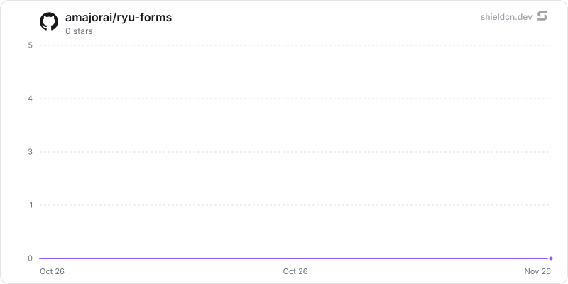

<p align="center">
  <picture>
    <source media="(prefers-color-scheme: dark)" srcset="./icon-dark.png" />
    
  </picture>
</p>

<div align="center">

# Forms

</div>

Create shareable no-code forms, collect responses on a Ryu node, and export submissions as CSV.

> **The public home of `ryu-forms`.** Source, builds, and releases live here —
> binaries for every platform are attached to each release.
>
> This tree is generated from the Ryu monorepo, so commits pushed here
> directly are replaced on the next sync. **Pull requests are welcome** —
> open them here and they are ported into the monorepo, then flow back out.
> Ryu as a whole: https://github.com/amajorai/ryu

## Install

**App:** [Install](ryu://apps/@ryu/forms) (opens the Ryu desktop app and asks you to confirm)

**CLI:**

```bash
ryu apps add @ryu/forms
```

## Source & build

The **source of record** for this app: a Bun/TypeScript
`sidecar/` Ryu runs locally as a grant-gated control capability, plus the
manifest `ui/`. The sidecar builds standalone — `cd sidecar && bun install &&
bun run build` compiles a single `ryu-forms` executable; each release attaches
the per-platform binaries.

## License

Apache-2.0 — see [LICENSE](./LICENSE).

## What it adds

- A **Forms** companion and sidebar button.
- The `ryu-forms` local sidecar, mounted at `/forms`, which stores forms and
  responses on the node. It runs only while the app is enabled and is reached
  through Core with the `app:http` grant.

## At rest

Respondent answers (`submissions.answers`) are sealed with the `@ryu/forms` plugin subkey
(`encb:v1:`, ChaCha20-Poly1305, store `forms.sqlite`, AAD bound to the submission id)
when they are written and opened when responses are listed or exported. Form definitions,
slugs, submission keys, timestamps and rate-limit counters stay plaintext (the editor,
paging and quotas query them).

The sidecar captures its key at startup (`capturePluginKeys`, the manifest grants
`crypto:seal`). Schema version 2 seals existing plaintext answers on open (cursor
pagination, compare-and-swap, resumable, a no-op the second time), with
`secure_delete = ON`, a WAL truncate, free pages zero-filled and a `VACUUM`, each when disk
space allows (otherwise at the next start; a failure never stops the sidecar from starting). A response that does not open is skipped and counted
(`sealing.unreadableRows` in `/api/forms/status`).

Key states: under a Core that delivers the key, answers are sealed; a store sealed under a
different key refuses new responses (`503 sealing_unavailable`) and keeps its data. Under an
older Core that delivers no key, a never-sealed store keeps storing answers in plaintext
(`sealing: "waiting for a Ryu update"`). Run standalone, the sidecar uses `RYU_MASTER_KEY`
or generates `<data dir>/secrets/standalone-root.key` (0600) and refuses a later different
key.

## Star History

<a href="https://github.com/amajorai/ryu-forms/stargazers">
  <picture>
    <source media="(prefers-color-scheme: dark)" srcset="./.github/shieldcn/star-chart-dark.svg" />
    
  </picture>
</a>
